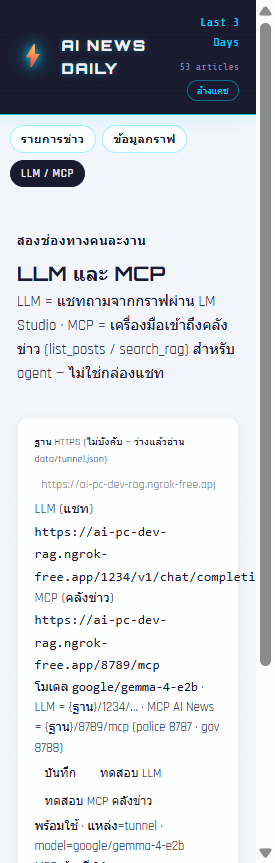
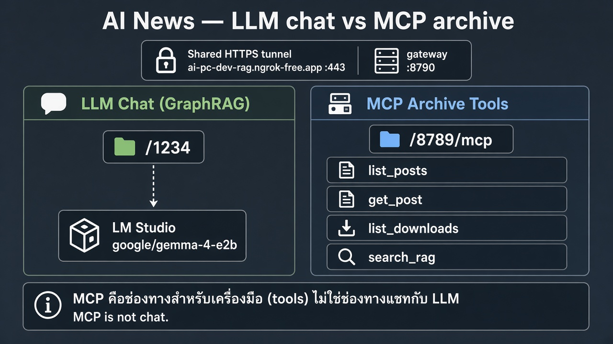
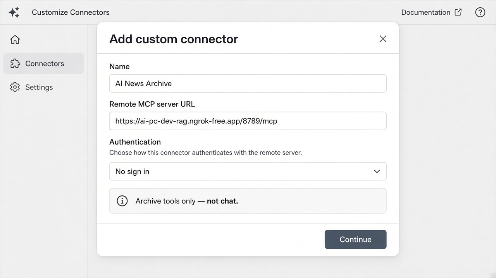
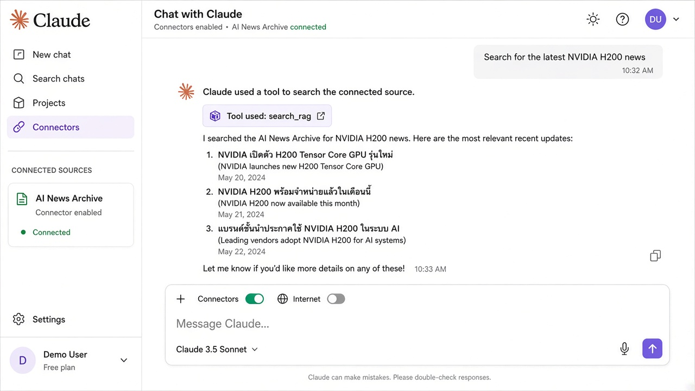

# AI News Daily

สรุปข่าว AI รายวันบน GitHub Pages — ค้นหาง่าย มี **ข้อมูลกราฟ (GraphRAG)** · **ค้นคลังข่าว** · **MCP สำหรับ agent**

เว็บ: https://chiraleo2000.github.io/ai-news/

| มุมมอง | ที่อยู่ |
| --- | --- |
| รายการข่าว (4 คอลัมน์) | `#/news` |
| ข้อมูลกราฟ + แชท LLM + ค้นคลัง | `#/brain` |
| LLM / MCP (สองช่องทางคนละงาน) | `#/connect` |

Pipeline skill: [`ai-news-master-claude-scheduler-propt.md`](ai-news-master-claude-scheduler-propt.md) (v1.3)  
**คู่มือ Claude Connector + MCP:** [`docs/mcp-claude-connector.md`](docs/mcp-claude-connector.md)  
Deploy skill: `.cursor/skills/ai-news-github-deploy/` (push แยก)

---

## หน้า GitHub Pages ใช้อย่างไร

เว็บนี้เป็นหน้าอ่านอย่างเดียว ข้อมูลข่าวมาจาก digest รายวัน (`data/*_news.json`)  
กราฟมาจาก workspace ผลิต **`ai-news-private`** แล้ว sync เข้า `data/graph.json`

### 1) รายการข่าว


- 4 คอลัมน์: **AI Trends · Tech Trends · Thailand · Global**
- ค้นหาหลายคำ (ไทย/EN) ในหัวข้อ องค์กร ผลิตภัณฑ์ แท็ก
- กรองช่วงวัน / ความเร่งด่วน / แหล่งข่าว / หัวข้อ + ชิปทางลัด
- ปุ่ม **ล้างแคช** มุมขวาบน = hard-reload ข้อมูล Pages

### 2) ข้อมูลกราฟ (GraphRAG)


- โหนดใหญ่ = องค์กร บุคคล สถานที่ สื่อ ผลิตภัณฑ์ · จุดเล็ก = หัวข่าว
- คอลัมน์ขวาบน: **แชทจากกราฟ (LLM)** — ใช้ LM Studio ผ่าน tunnel (`/1234`) — **ไม่ใช่ MCP**
- คอลัมน์ขวาล่าง: **ค้นคลังข่าว** — ค้น archive ในหน้า / หรือ MCP `search_rag` เมื่อ tunnel พร้อม
- ลากพื้นหลังเลื่อน · สกอร์ลซูม · ดับเบิลคลิกโหนด = โฟกัสเพื่อนบ้าน

### 3) LLM / MCP



- ถ้าเว้นว่าง หน้าเว็บอ่าน `data/tunnel.json` แล้วประกอบที่อยู่เอง
- โมเดลค่าเริ่มต้น: `google/gemma-4-e2b`
- **LLM (แชท)** = `{ฐาน}/1234/v1/chat/completions`
- **MCP (คลังข่าว)** = `{ฐาน}/8789/mcp`

---

## เชื่อม Claude Connector กับ MCP (คลังข่าว)

MCP = เครื่องมือให้ **Claude / Cursor / agent** อ่านคลังข่าว — **ไม่ใช่แชทบนหน้าเว็บ**



### URL ที่ใส่ใน Claude

```
https://ai-pc-dev-rag.ngrok-free.app/8789/mcp
```

(ดูค่าล่าสุดใน `data/tunnel.json` → ฟิลด์ `mcp`)

### Claude.ai — เพิ่ม Custom Connector

1. **Customize → Connectors → Add custom connector**
2. Name: `AI News Archive`
3. Remote MCP server URL: ตามด้านบน
4. Authentication: **No sign in**
5. ในแชทเปิด Connectors แล้วสั่ง เช่น  
   `ใช้ search_rag ค้น "NVIDIA H200" แล้วสรุปจากผล tool เท่านั้น`





### Claude Desktop (`claude_desktop_config.json`)

```json
{
  "mcpServers": {
    "ai-news-archive": {
      "command": "npx",
      "args": [
        "-y",
        "mcp-remote",
        "https://ai-pc-dev-rag.ngrok-free.app/8789/mcp"
      ]
    }
  }
}
```

คู่มือเต็ม (เตรียม tunnel · แก้ปัญหา · Cursor config):  
**[`docs/mcp-claude-connector.md`](docs/mcp-claude-connector.md)**

ก่อนเชื่อม ให้เปิดบริการ:

```powershell
Set-Location C:\Users\AI-PC-DEV\Documents\ai-news
.\ops\Ensure-AiNewsServices.ps1 -Wake
```

---

## สองบทบาทของ repo นี้

| Role | Path | GitHub |
| --- | --- | --- |
| **Public Pages kit** (repo นี้) | `C:\Users\AI-PC-DEV\Documents\ai-news` | https://github.com/chiraleo2000/ai-news |
| **Private GraphRAG** | `C:\Users\AI-PC-DEV\Documents\ai-news-private` | https://github.com/chiraleo2000/ai-news-private |

### 1) Static GitHub Pages (หลัก)

Workflow `.github/workflows/static.yml` publish จาก **repo root**:

```
index.html · assets/ · js/ · data/
```

โฟลเดอร์ `github-pages/` เป็น mirror สำหรับ preview/local — ข้อมูลจริงที่ขึ้นเว็บอยู่ที่ root `data/`

### 2) Optional local MCP / tunnel (เสริม)

```powershell
Set-Location C:\Users\AI-PC-DEV\Documents\ai-news
.\ops\wake-tunnel.ps1 -Wake
# หรือเฉพาะ MCP:
# $env:PORT=8789; node mcp/server.mjs
```

| บริการ | พอร์ต |
| --- | --- |
| **AI News MCP** | `:8789` |
| Police MCP | `:8787` |
| Gov MCP | `:8788` |
| Gateway (แชร์) | `:8790` |
| LM Studio (แชท Pages) | `:1234` |

MCP tools: `list_posts` · `get_post` · `list_downloads` · `search_rag`

Scheduler: `.\ops\Register-AiNewsScheduler.ps1` → `AiNewsWakeTunnel` + `AiNewsLmsWatch`

---

## การใช้งานประจำวัน (สรุป)

### Scrape + publish (ไม่ push)

ใช้ skill / prompt: `ai-news-master-claude-scheduler-propt.md`

1. ล้างแคช local: `.\ops\Clear-AiNewsCache.ps1`
2. กวาด Batch 1/2/3 → `News/Batches/{DATE}/`
3. สร้าง `Document/{DATE}_News/{DATE}_news.{json,html,pdf}`
4. Copy ไป `data/` + `github-pages/data/` (file copy เท่านั้น)
5. Rebuild GraphRAG ใน private แล้ว sync กลับ public
6. **หยุด — อย่า git push ใน skill นี้**

### Deploy Pages

รัน skill `ai-news-github-deploy` หรือ push `master` ด้วยมือ — หลัง push ให้ hard-refresh หรือกด **ล้างแคช**

### Rebuild GraphRAG อย่างเดียว

ดู README ของ private: [`ai-news-private`](https://github.com/chiraleo2000/ai-news-private)

```powershell
Set-Location C:\Users\AI-PC-DEV\Documents\ai-news-private
Copy-Item ..\ai-news\data\*_news.json .\data\ -Force
node ops/build-ai-news-graph.js
.\ops\sync-to-public.ps1
```

แล้ว push จาก public kit

---

## โครงสร้างสำคัญ

```
ai-news/                          # public kit
  index.html · assets/ · js/      # Pages UI
  data/*_news.json · graph.json   # ข้อมูลที่ Pages อ่าน
  data/tunnel.json                # HTTPS base สำหรับ LLM + MCP
  mcp/server.mjs                  # MCP archive tools (:8789)
  docs/mcp-claude-connector.md    # คู่มือ Claude Connector
  docs/images/                    # ภาพประกอบ README / คู่มือ
  ops/wake-tunnel.ps1
  ops/Ensure-AiNewsServices.ps1
  ops/Register-AiNewsScheduler.ps1
  Document/{DATE}_News/           # digest รายวัน
  ai-news-master-claude-scheduler-propt.md
```

เวอร์ชัน UI / pipeline: `data/version.json`
