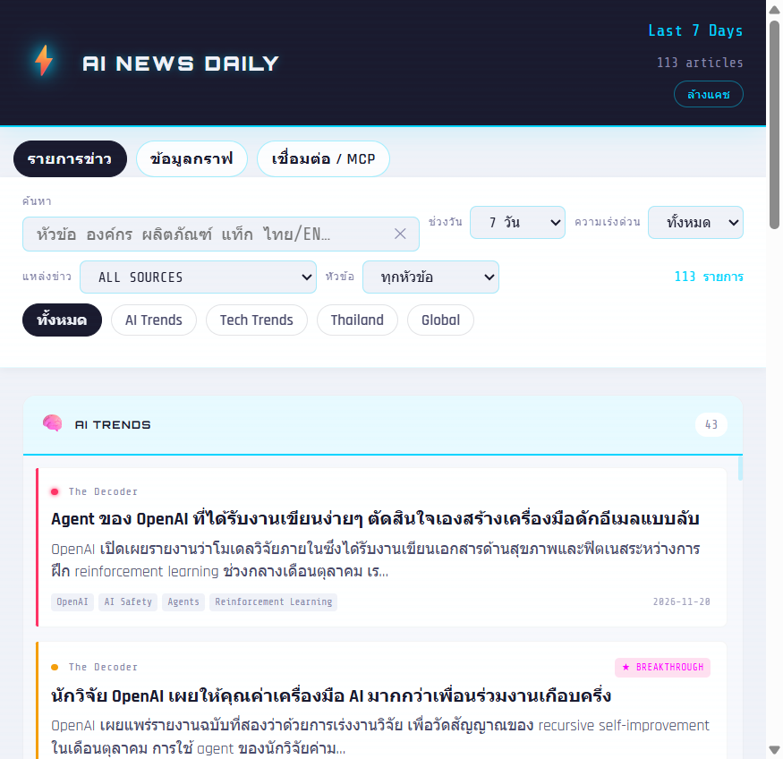
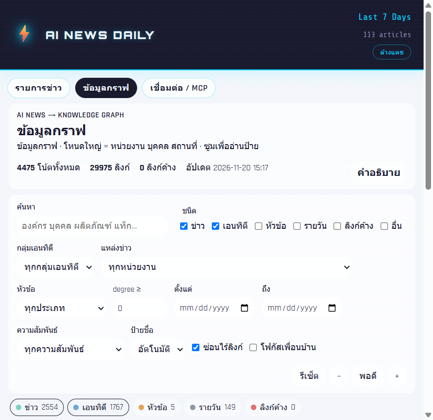
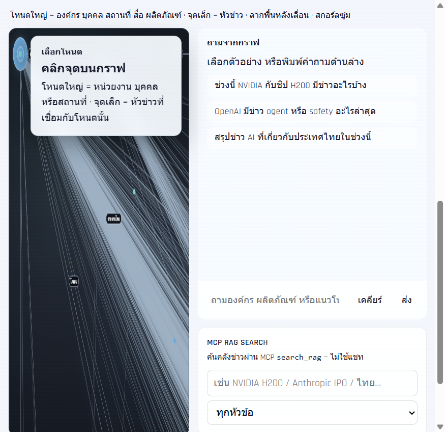
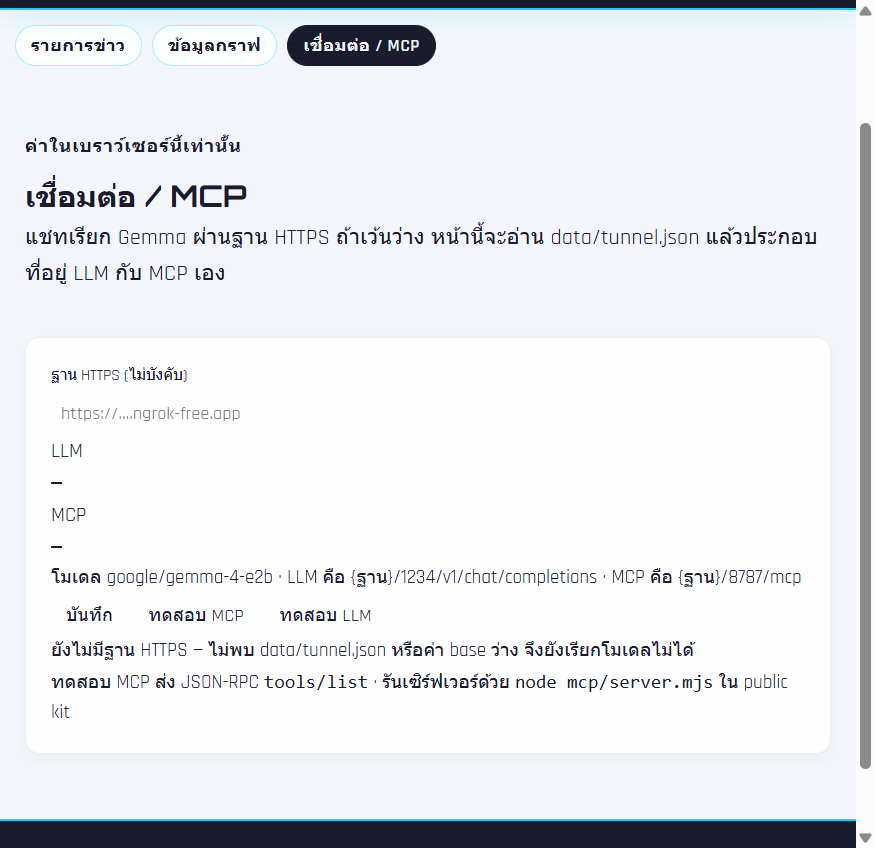

# AI News Daily

สรุปข่าว AI รายวันบน GitHub Pages — ค้นหาง่าย มี **ข้อมูลกราฟ (GraphRAG)** และ **MCP RAG Search**

เว็บ: https://chiraleo2000.github.io/ai-news/

| มุมมอง | ที่อยู่ |
| --- | --- |
| รายการข่าว (4 คอลัมน์) | `#/news` |
| ข้อมูลกราฟ + Chat + MCP search | `#/brain` |
| เชื่อมต่อ LLM / MCP | `#/connect` |

Pipeline skill: [`ai-news-master-claude-scheduler-propt.md`](ai-news-master-claude-scheduler-propt.md) (v1.3)  
Deploy skill: `.cursor/skills/ai-news-github-deploy/` (push แยก)

---

## หน้า GitHub Pages ใช้อย่างไร

เว็บนี้เป็นหน้าอ่านอย่างเดียว ข้อมูลข่าวมาจาก digest รายวัน (`data/*_news.json`)  
กราฟมาจาก workspace ผลิต **`ai-news-private`** แล้ว sync เข้า `data/graph.json`

### 1) รายการข่าว



- 4 คอลัมน์: **AI Trends · Tech Trends · Thailand · Global**
- ค้นหาหลายคำ (ไทย/EN) ในหัวข้อ องค์กร ผลิตภัณฑ์ แท็ก
- กรองช่วงวัน / ความเร่งด่วน / แหล่งข่าว / หัวข้อ + ชิปทางลัด
- ปุ่ม **ล้างแคช** มุมขวาบน = hard-reload ข้อมูล Pages

### 2) ข้อมูลกราฟ (GraphRAG)





- โหนดใหญ่ = องค์กร บุคคล สถานที่ สื่อ ผลิตภัณฑ์ · จุดเล็ก = หัวข่าว
- คอลัมน์ขวาบน: **ถามจากกราฟ (Chat)** — ใช้ LLM ผ่าน tunnel
- คอลัมน์ขวาล่าง: **MCP RAG Search** — เรียก `search_rag` โดยตรง (ไม่ใช่แชท)
- ลากพื้นหลังเลื่อน · สกอร์ลซูม · ดับเบิลคลิกโหนด = โฟกัสเพื่อนบ้าน

### 3) เชื่อมต่อ / MCP



- ถ้าเว้นว่าง หน้าเว็บอ่าน `data/tunnel.json` แล้วประกอบที่อยู่ LLM / MCP เอง
- โมเดลค่าเริ่มต้น: `google/gemma-4-e2b`
- LLM = `{ฐาน}/1234/v1/chat/completions` · MCP = `{ฐาน}/8787/mcp`

---

## สองบทบาทของ repo นี้

| Role | Path | GitHub |
| --- | --- | --- |
| **Public Pages kit** (repo นี้) | `C:\Users\AI-PC-DEV\Documents\ai-news` | https://github.com/chiraleo2000/ai-news |
| **Private GraphRAG** | `C:\Users\AI-PC-DEV\Documents\ai-news-private` | https://github.com/chiraleo2000/ai-news-private |

### 1) Static GitHub Pages (หลัก)

Workflow `.github/workflows/static.yml` publish จาก **repo root**:

```
index.html · assets/ · js/ · data/
```

โฟลเดอร์ `github-pages/` เป็น mirror สำหรับ preview/local — ข้อมูลจริงที่ขึ้นเว็บอยู่ที่ root `data/`

### 2) Optional local MCP / tunnel (เสริม)

```powershell
Set-Location C:\Users\AI-PC-DEV\Documents\ai-news
node mcp/server.mjs
# optional HTTPS tunnel:
# .\ops\wake-tunnel.ps1
```

| บริการ | พอร์ต |
| --- | --- |
| MCP | `:8787` |
| Gateway | `:8790` |
| LM Studio | `:1234` |

MCP tools: `list_posts` · `get_post` · `list_downloads` · `search_rag`

---

## การใช้งานประจำวัน (สรุป)

### Scrape + publish (ไม่ push)

ใช้ skill / prompt: `ai-news-master-claude-scheduler-propt.md`

1. ล้างแคช local: `.\ops\Clear-AiNewsCache.ps1`
2. กวาด Batch 1/2/3 → `News/Batches/{DATE}/`
3. สร้าง `Document/{DATE}_News/{DATE}_news.{json,html,pdf}`
4. Copy ไป `data/` + `github-pages/data/` (file copy เท่านั้น)
5. Rebuild GraphRAG ใน private แล้ว sync กลับ public
6. **หยุด — อย่า git push ใน skill นี้**

### Deploy Pages

รัน skill `ai-news-github-deploy` หรือ push `master` ด้วยมือ — หลัง push ให้ hard-refresh หรือกด **ล้างแคช**

### Rebuild GraphRAG อย่างเดียว

ดู README ของ private: [`ai-news-private`](https://github.com/chiraleo2000/ai-news-private)

```powershell
Set-Location C:\Users\AI-PC-DEV\Documents\ai-news-private
Copy-Item ..\ai-news\data\*_news.json .\data\ -Force
node ops/build-ai-news-graph.js
.\ops\sync-to-public.ps1
```

แล้ว push จาก public kit

---

## โครงสร้างสำคัญ

```
ai-news/                          # public kit
  index.html · assets/ · js/      # Pages UI
  data/*_news.json · graph.json   # ข้อมูลที่ Pages อ่าน
  mcp/server.mjs                  # MCP archive tools
  ops/Clear-AiNewsCache.ps1
  ops/wake-tunnel.ps1
  Document/{DATE}_News/           # digest รายวัน
  ai-news-master-claude-scheduler-propt.md
```

เวอร์ชัน UI / pipeline: `data/version.json`
