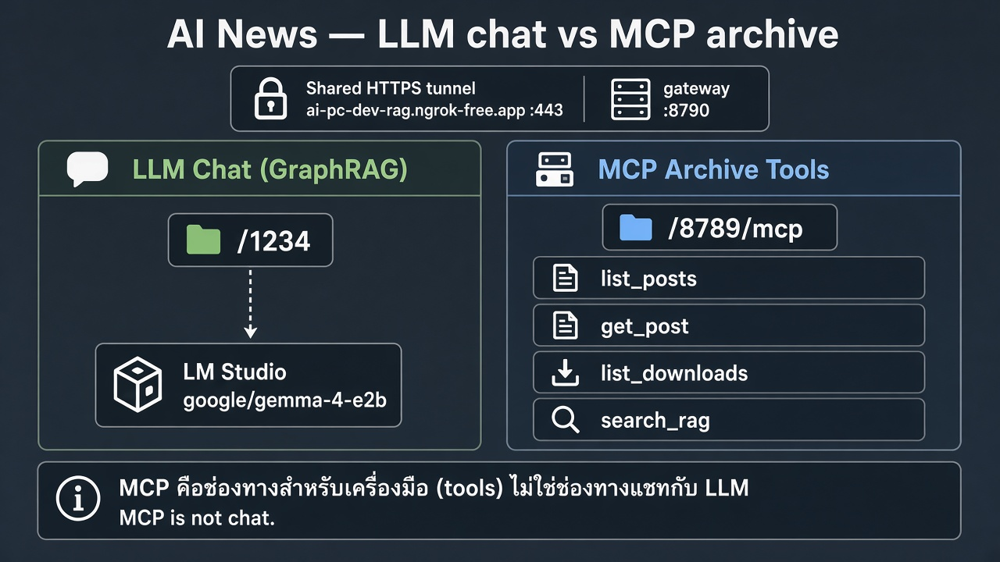
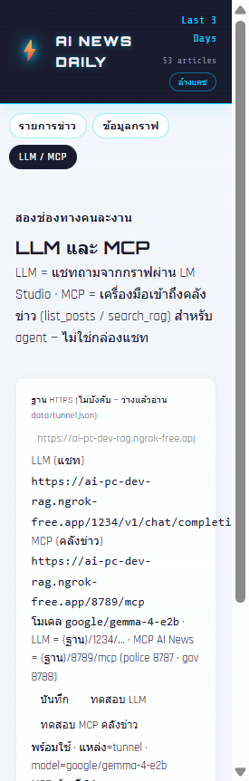
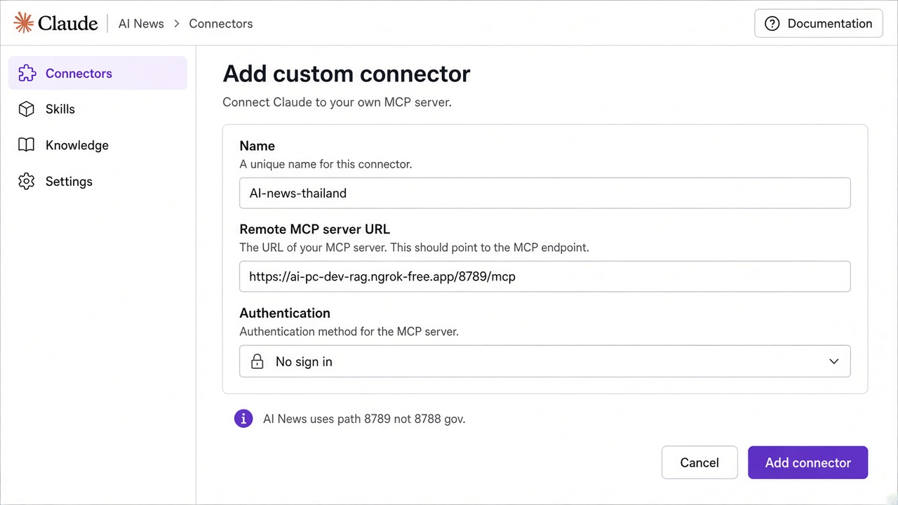
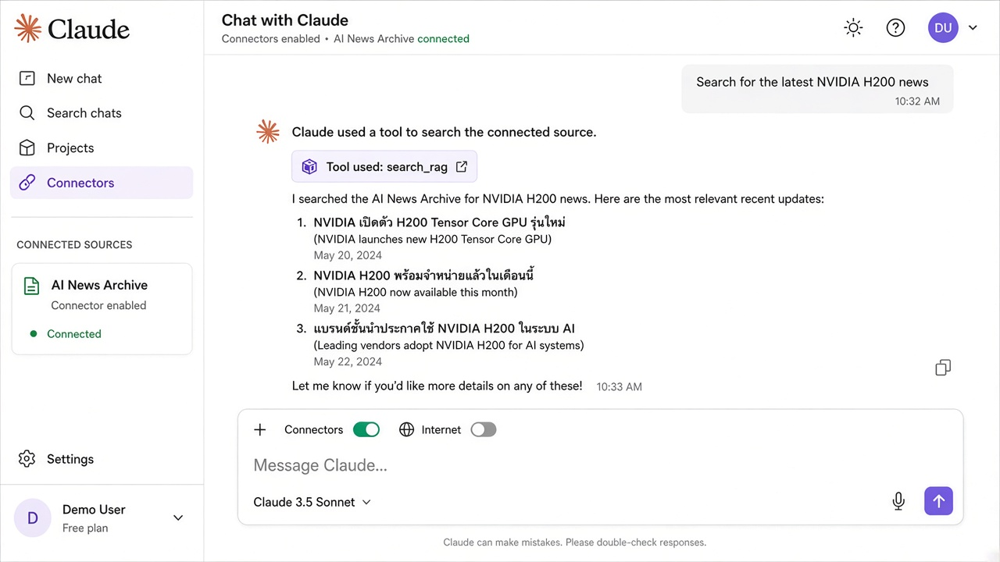

# เชื่อม AI News MCP กับ Claude Connector

MCP ของ AI News เป็น **เครื่องมือเข้าถึงคลังข่าว** (`list_posts` · `get_post` · `list_downloads` · `search_rag`)  
**ไม่ใช่กล่องแชท** — แชท GraphRAG ใช้ LLM ที่ `:1234` คนละช่องทาง



| ช่องทาง | URL (หลัง wake tunnel) | ใช้ทำอะไร |
| --- | --- | --- |
| **MCP (archive)** | `https://ai-pc-dev-rag.ngrok-free.app/8789/mcp` | Claude / Cursor / agent เรียก tools ค้นข่าว |
| **LLM (chat)** | `https://ai-pc-dev-rag.ngrok-free.app/1234/v1/chat/completions` | หน้า Pages แท็บกราฟถาม Gemma |
| Gateway | `:8790` (แชร์กับ police/gov) | proxy path `/1234` `/8787` `/8788` `/8789` |

ค่าจริงบน Pages: แท็บ **LLM / MCP** หรือไฟล์ [`data/tunnel.json`](../data/tunnel.json)



---

## เตรียมเซิร์ฟเวอร์ก่อนเชื่อม Claude

Claude Custom Connector เรียก MCP จาก **คลาวด์ของ Anthropic** ต้องเป็น HTTPS พอร์ต **443** (path `/8789/mcp` บนโดเมน ngrok ใช้ได้ — ห้ามใส่ `:8789` หลังโฮสต์)

```powershell
Set-Location C:\Users\AI-PC-DEV\Documents\ai-news
.\ops\Ensure-AiNewsServices.ps1 -Wake
# หรือ: .\ops\wake-tunnel.ps1 -Wake
```

ตรวจเร็ว:

```powershell
$body = '{"jsonrpc":"2.0","id":1,"method":"tools/list"}'
Invoke-RestMethod -Uri "https://ai-pc-dev-rag.ngrok-free.app/8789/mcp" `
  -Method POST -Body $body -ContentType "application/json" `
  -Headers @{ "ngrok-skip-browser-warning" = "true" }
```

ต้องเห็น tools: `list_posts`, `get_post`, `list_downloads`, `search_rag`

---

## A) Claude.ai — Custom Connector (แนะนำ)

เอกสารทางการ: [Get started with custom connectors using remote MCP](https://support.claude.com/en/articles/11175166-get-started-with-custom-connectors-using-remote-mcp)

### ขั้นตอน (Pro / Max)

1. เปิด **Customize → Connectors**
2. **+ Add → Add custom connector** (หรือ Add → Custom → Web บน Team)
3. กรอกตามตัวอย่างด้านล่าง → Continue
4. Authentication: เลือก **No sign in** (เซิร์ฟเวอร์นี้ไม่ใช้ OAuth)
5. บันทึก → ในแชทเปิด Connectors แล้วเปิดใช้ **AI-news-thailand**



### ค่าที่กรอก (คู่กับ gov)

| ช่อง | gov-news-thailand | **AI-news-thailand** |
| --- | --- | --- |
| **Name** | `gov-news-thailand` | `AI-news-thailand` |
| **URL** | `https://ai-pc-dev-rag.ngrok-free.app/8788/mcp` | `https://ai-pc-dev-rag.ngrok-free.app/8789/mcp` |
| **Auth** | `No sign in` | `No sign in` |

สรุปสำหรับ AI News อย่างเดียว:

| ช่อง | ค่า |
| --- | --- |
| **Name** | `AI-news-thailand` |
| **URL** | `https://ai-pc-dev-rag.ngrok-free.app/8789/mcp` |
| **Auth** | `No sign in` |

> อย่าใส่ URL ของ `:8788` ให้ AI News — พอร์ตนั้นเป็น **gov-news**  
> AI News = **`:8789`** · police = `:8787` · LLM chat = `:1234`  
> URL ต้องตรงกับ `data/tunnel.json` → ฟิลด์ `mcp`

### ตัวอย่างคำสั่งในแชท Claude

```
ใช้ search_rag ค้น "NVIDIA H200" limit 5 แล้วสรุปเป็นภาษาไทยจากผล tool เท่านั้น
```

```
list_posts วันที่วันนี้ (หรือวันที่ล่าสุดในคลัง) แล้ว get_post รายการแรก
```



---

## B) Claude Desktop — local MCP via `mcp-remote`

Remote connector บน Desktop ก็ผ่านบัญชี Claude เหมือนเว็บ  
ถ้าต้องการรันผ่านเครื่อง (stdio → remote HTTP) ใส่ใน  
`%APPDATA%\Claude\claude_desktop_config.json`:

```json
{
  "mcpServers": {
    "AI-news-thailand": {
      "command": "npx",
      "args": [
        "-y",
        "mcp-remote",
        "https://ai-pc-dev-rag.ngrok-free.app/8789/mcp"
      ]
    }
  }
}
```

รีสตาร์ท Claude Desktop แล้วเช็ก Tools ว่ามี `search_rag` / `list_posts`

---

## C) Cursor — MCP config

ไฟล์โปรเจกต์หรือ user MCP (ตัวอย่าง):

```json
{
  "mcpServers": {
    "ai-news-archive": {
      "url": "https://ai-pc-dev-rag.ngrok-free.app/8789/mcp"
    }
  }
}
```

หรือแบบ command เหมือน Desktop:

```json
{
  "mcpServers": {
    "ai-news-archive": {
      "command": "npx",
      "args": ["-y", "mcp-remote", "https://ai-pc-dev-rag.ngrok-free.app/8789/mcp"]
    }
  }
}
```

---

## Tools ที่ Claude จะเห็น

ฐานเดียว: `data/ai-news-mcp.sqlite` (collections แยกค้นได้)

| Tool | หน้าที่ |
| --- | --- |
| `search_rag` | ค้น ranked + sub-embedding chunks · `scope=posts\|analysis\|downloads\|all` (ค่าเริ่มต้น posts) |
| `search_analysis` | ค้นเฉพาะ analysis (`tech_impact` / `_tech_summary`) |
| `search_downloads` | ค้นเฉพาะไฟล์ digest PDF/HTML (+ metadata รูป) |
| `list_posts` | ลิสต์โพสต์ กรอง `date` / `q` / `limit` |
| `get_post` | ดึงโพสต์เต็มด้วย `id` เช่น `20261120-b1-01` |
| `list_downloads` | ลิสต์ไฟล์ใน store (Document + data/downloads) |
| `get_store_doc` | ดึงเอกสารใน store ตาม `post:…` / `analysis:…` / `download:…` |
| `store_stats` | จำนวน docs/chunks/embeddings |

Rebuild store:

```powershell
.\ops\Rebuild-McpStore.ps1 -Force
# หรือเร็วแบบไม่มี vector:
.\ops\Rebuild-McpStore.ps1 -Force -NoEmbed
# หรือ: node mcp/index-store.mjs --force --no-embed
```

เซิร์ฟเวอร์อ่านเฉพาะไฟล์ใน `data/*_news.json` ที่ publish แล้ว — **ไม่แต่งข่าว**

---

## พอร์ตที่อย่าสับสน

| พอร์ต | เจ้าของ |
| --- | --- |
| `:8789` | **AI News** MCP (ตัวนี้) |
| `:8787` | Police news MCP |
| `:8788` | Gov news MCP |
| `:1234` | LM Studio (แชท Pages — ไม่ใช่ Claude connector) |

---

## แก้ปัญหาเร็ว

| อาการ | ตรวจ |
| --- | --- |
| Claude เชื่อมไม่ได้ | tunnel ตื่นไหม · URL เป็น HTTPS :443 · path มี `/mcp` |
| tools ไม่ครบ / ไม่มี `search_rag` | กำลังยิงพอร์ตผิด (8787/8788) · รัน `wake-tunnel.ps1 -Wake` |
| ตอบข่าวมั่ว | ย้ำในพรอมป์ว่าใช้ผล tool เท่านั้น · อย่าใช้ LLM Pages เป็น MCP |
| ngrok interstitial | ใส่ header `ngrok-skip-browser-warning: true` ตอนทดสอบด้วย curl/PowerShell |

เปิดบริการค้างไว้:

```powershell
.\ops\Register-AiNewsScheduler.ps1   # AiNewsWakeTunnel + AiNewsLmsWatch
.\ops\Ensure-AiNewsServices.ps1 -Wake
```
